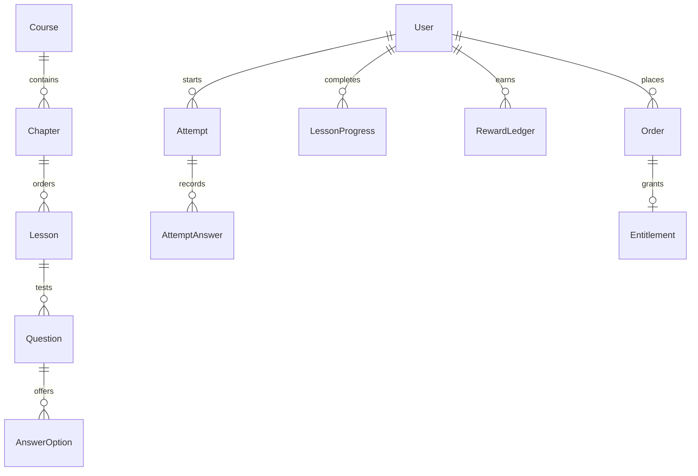

# Database inventory

49 models. `schema.prisma` is authoritative; the SQL migration adds constraints and RLS defense.

| Model | Main fields | Relations |
|---|---|---|
| User | id: String, name: String?, email: String?, emailVerified: DateTime?, image: String?, username: String?, bio: String, university: String, role: Role, publicProfile: Boolean, goalMinutes: Int, timezone: String, emailReminders: Boolean, createdAt: DateTime, updatedAt: DateTime | account_user → Account[], session_user → Session[], enrollment_user → Enrollment[], lessonProgress_user → LessonProgress[], attempt_user → Attempt[], lessonBookmark_user → LessonBookmark[], questionBookmark_user → QuestionBookmark[], highlight_user → Highlight[], reviewCard_user → ReviewCard[], game → GameState?, rewardLedger_user → RewardLedger[], dailyActivity_user → DailyActivity[], missionClaim_user → MissionClaim[], wheelSpin_user → WheelSpin[], userBadge_user → UserBadge[], certificate_user → Certificate[], leagueEntry_user → LeagueEntry[], post_author → Post[], media_owner → Media[], comment_author → Comment[], postLike_user → PostLike[], postBookmark_user → PostBookmark[], follow_follower → Follow[], follow_following → Follow[], report_reporter → Report[], order_user → Order[], entitlement_user → Entitlement[], couponRedemption_user → CouponRedemption[], studentVerification_user → StudentVerification[], notification_user → Notification[], ticket_user → Ticket[], ticketMessage_author → TicketMessage[], feedback_user → Feedback[], auditLog_actor → AuditLog[] |
| Account | id: String, type: String, provider: String, providerAccountId: String, refresh_token: String?, access_token: String?, expires_at: Int?, token_type: String?, scope: String?, id_token: String?, session_state: String?, userId: String | user → User |
| Session | id: String, sessionToken: String, expires: DateTime, userId: String | user → User |
| VerificationToken | identifier: String, token: String, expires: DateTime |  |
| Specialty | id: String, slug: String, title: String, description: String, icon: String, position: Int | courses → Course[] |
| Course | id: String, slug: String, title: String, description: String, access: Access, status: ContentStatus, specialtyId: String, createdAt: DateTime | specialty → Specialty, chapters → Chapter[], enrollment_course → Enrollment[], certificate_course → Certificate[], product_course → Product[], entitlement_course → Entitlement[] |
| Chapter | id: String, title: String, guide: String, position: Int, courseId: String | course → Course, lessons → Lesson[] |
| Lesson | id: String, slug: String, title: String, position: Int, estimatedMinutes: Int, freePreview: Boolean, status: ContentStatus, reviewedAt: DateTime?, reviewerName: String?, version: Int, chapterId: String | chapter → Chapter, blocks → LessonBlock[], questions → Question[], progress → LessonProgress[], attempt_lesson → Attempt[], lessonBookmark_lesson → LessonBookmark[] |
| LessonBlock | id: String, position: Int, kind: String, text: String, mediaUrl: String?, sourceUrl: String?, lessonId: String | lesson → Lesson, highlight_block → Highlight[] |
| Question | id: String, position: Int, kind: QuestionKind, prompt: String, explanation: String, hint: String?, lessonId: String | lesson → Lesson, options → AnswerOption[], attemptAnswer_question → AttemptAnswer[], questionBookmark_question → QuestionBookmark[], reviewCard_question → ReviewCard[], report_question → Report[] |
| AnswerOption | id: String, text: String, isCorrect: Boolean, position: Int, questionId: String | question → Question, attemptAnswer_option → AttemptAnswer[] |
| Enrollment | id: String, createdAt: DateTime, userId: String, courseId: String | user → User, course → Course |
| LessonProgress | id: String, completedAt: DateTime, bestScore: Int, userId: String, lessonId: String | user → User, lesson → Lesson |
| Attempt | id: String, startedAt: DateTime, completedAt: DateTime?, expiresAt: DateTime, score: Int, lessonVersion: Int, userId: String, lessonId: String | user → User, lesson → Lesson, answers → AttemptAnswer[] |
| AttemptAnswer | id: String, correct: Boolean, answeredAt: DateTime, attemptId: String, questionId: String, optionId: String | attempt → Attempt, question → Question, option → AnswerOption |
| LessonBookmark | id: String, createdAt: DateTime, userId: String, lessonId: String | user → User, lesson → Lesson |
| QuestionBookmark | id: String, userId: String, questionId: String | user → User, question → Question |
| Highlight | id: String, quote: String, note: String, createdAt: DateTime, userId: String, blockId: String | user → User, block → LessonBlock |
| ReviewCard | id: String, dueAt: DateTime, intervalDays: Int, userId: String, questionId: String | user → User, question → Question |
| GameState | id: String, xp: Int, gems: Int, hearts: Int, heartsUpdatedAt: DateTime, streak: Int, lastStudyDay: String?, streakGuards: Int, userId: String | user → User |
| RewardLedger | id: String, key: String, xp: Int, gems: Int, reason: String, createdAt: DateTime, userId: String | user → User |
| DailyActivity | id: String, day: String, seconds: Int, lessons: Int, xp: Int, userId: String | user → User |
| MissionClaim | id: String, day: String, mission: String, createdAt: DateTime, userId: String | user → User |
| WheelSpin | id: String, day: String, prize: String, gems: Int, userId: String | user → User |
| Badge | id: String, slug: String, title: String, description: String, category: String, threshold: Int | awards → UserBadge[] |
| UserBadge | id: String, awardedAt: DateTime, userId: String, badgeId: String | user → User, badge → Badge |
| Certificate | id: String, code: String, issuedAt: DateTime, nameSnapshot: String, courseSnapshot: String, revokedAt: DateTime?, userId: String, courseId: String | user → User, course → Course |
| LeagueSeason | id: String, period: String, startsAt: DateTime, endsAt: DateTime, settledAt: DateTime? | leagueEntry_season → LeagueEntry[] |
| LeagueEntry | id: String, xp: Int, rank: Int?, rewardGems: Int, seasonId: String, userId: String | season → LeagueSeason, user → User |
| Post | id: String, body: String, createdAt: DateTime, updatedAt: DateTime, deletedAt: DateTime?, authorId: String | author → User, media_post → Media[], comments → Comment[], likes → PostLike[], bookmarks → PostBookmark[], report_post → Report[] |
| Media | id: String, objectKey: String, mimeType: String, size: Int, status: String, createdAt: DateTime, ownerId: String, postId: String? | owner → User, post → Post? |
| Comment | id: String, body: String, createdAt: DateTime, deletedAt: DateTime?, authorId: String, postId: String | author → User, post → Post |
| PostLike | id: String, userId: String, postId: String | user → User, post → Post |
| PostBookmark | id: String, userId: String, postId: String | user → User, post → Post |
| Follow | id: String, createdAt: DateTime, followerId: String, followingId: String | follower → User, following → User |
| Report | id: String, reason: String, status: String, createdAt: DateTime, reporterId: String, postId: String?, questionId: String? | reporter → User, post → Post?, question → Question? |
| Product | id: String, slug: String, title: String, description: String, kind: ProductKind, priceCents: Int, currency: String, durationDays: Int?, gems: Int, active: Boolean, stripePriceId: String?, courseId: String? | course → Course?, order_product → Order[] |
| Order | id: String, status: OrderStatus, amountCents: Int, currency: String, stripeSessionId: String?, createdAt: DateTime, paidAt: DateTime?, userId: String, productId: String | user → User, product → Product, entitlement → Entitlement? |
| Entitlement | id: String, startsAt: DateTime, endsAt: DateTime?, revokedAt: DateTime?, orderId: String, userId: String, courseId: String? | order → Order, user → User, course → Course? |
| WebhookEvent | id: String, processedAt: DateTime, type: String |  |
| Coupon | id: String, code: String, percent: Int, expiresAt: DateTime, maxUses: Int, stripeCouponId: String? | couponRedemption_coupon → CouponRedemption[] |
| CouponRedemption | id: String, userId: String, couponId: String | user → User, coupon → Coupon |
| StudentVerification | id: String, objectKey: String, status: String, createdAt: DateTime, reviewedAt: DateTime?, expiresAt: DateTime?, userId: String | user → User |
| Notification | id: String, title: String, body: String, href: String?, readAt: DateTime?, createdAt: DateTime, userId: String | user → User |
| Ticket | id: String, subject: String, status: String, createdAt: DateTime, userId: String | user → User, messages → TicketMessage[] |
| TicketMessage | id: String, body: String, createdAt: DateTime, ticketId: String, authorId: String | ticket → Ticket, author → User |
| Feedback | id: String, body: String, createdAt: DateTime, userId: String | user → User |
| AuditLog | id: String, action: String, entityId: String?, createdAt: DateTime, actorId: String? | actor → User? |
| RateLimit | id: String, count: Int, expiresAt: DateTime |  |

## Core relationships

## Integrity rules

Unique user/lesson progress; unique attempt/question answers; unique reward idempotency keys; unique user/day wheel spins and mission claims; unique event IDs for payments; unique user/season entries. Cascade on user-owned learning/social records; product deletion is restricted if referenced by an order. Financial retention needs a separate anonymization policy before implementing account deletion.
